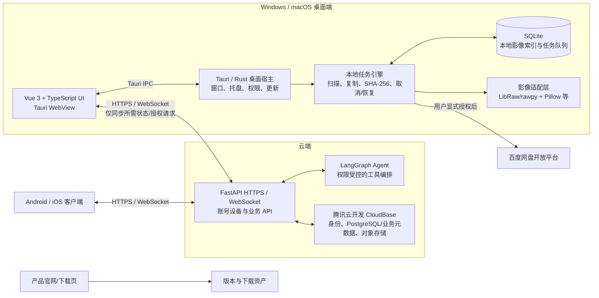

# 影趣 Agent 智能影像资料管理软件｜技术框架

> 状态：讨论稿 v0.1（2026-10-25）
> 本文是技术路线的唯一维护文档。后续确认或修改时直接更新本文件，不另建同主题版本。
> 推荐建立在目前口述需求和空仓库之上；收到旧软件源码后先审计，再决定复用或调整。当前没有实现、构建、部署或验收结果。

## 1. 项目判断

- **产品形态**：Windows/macOS 桌面应用为本阶段重点，另有 Android/iOS 客户端和产品官网；共享账号及云端 API 提供跨端同步。
- **AI 深度**：主流程为 **L3 Agent**（模型选择受限工具完成多步任务）；影像质量识别属于 **L2**。普通文件复制、哈希校验、进度统计必须是可测试的确定性代码，不交给 LLM 决策。
- **主架构原则**：本地文件操作在桌面设备；云服务不直接读取用户电脑文件。云端负责身份、同步、Agent 编排和审计；桌面端保留原片、索引和本地任务执行能力。
- **开发先后**：先建立桌面端 UI 和可替换的接口层；先用 fixture/mock 逐项验证交互，再按垂直切片接入真实功能。Android/iOS 本轮只约定协议，不做实现。

## 2. 推荐总体架构

**边界重点**：备份不能依赖互联网或 FastAPI 才能读取本机文件；App UI 通过 Tauri IPC 启动、暂停和查询本地任务。桌面向 FastAPI 发送最少必要的进度/设备状态；手机经云端看状态。文件上传到百度网盘由桌面端在用户授权后直传，不先上传到本产品云端再转发。

## 3. 分层选型

| 层 | 推荐 | 选择理由与限制 |
|---|---|---|
| 桌面前端 | Vue 3 + TypeScript + Vite（暂定） | 适合快速构建状态型桌面 UI；若旧软件已有稳定的 React/Vue 技术栈且维护成本更低，优先评估复用，不为统一而迁移 |
| 桌面容器 | Tauri 2 + Rust 宿主 | 负责窗口、文件权限边界、系统托盘/菜单、生命周期、更新器接口和本地任务调用；构建与签名仍需 Windows/macOS 分别验证 |
| 本地持久化 | SQLite；FTS5 用于全文检索 | 存文件索引、任务状态、目的地状态、报告索引和待上传事件。FTS5 是 SQLite 的全文检索模块，不是独立的照片搜索服务；元数据结构化过滤仍用普通索引 |
| 本地任务引擎 | Rust 异步 worker + SQLite 持久任务表 | 管本机文件句柄、复制、校验、暂停/取消和崩溃恢复；使用有界并发，避免内存中队列成为唯一任务状态 |
| RAW 解码/影像适配 | LibRaw（优先通过经过验证的绑定/隔离适配层）；Pillow 用于常规预览/衍生图 | RAW 读取和普通像素图处理职责不同；确认打包体积、CPU/内存、相机样本覆盖和许可证后再固定绑定。LibRaw 自身不承诺高质量生产级 RAW 渲染 |
| 云端业务 API | FastAPI，部署在受控云托管/容器环境 | 负责会话鉴权、设备、任务元数据、Agent 入口、百度网盘 OAuth 协调和 WebSocket；不负责直接打开桌面硬盘路径 |
| Agent | LangGraph 作为云端多步流程候选 | 只编排类型化工具；桌面文件动作要经已登录桌面设备的本地 Agent Bridge 校验，不把 LangGraph 当备份队列 |
| 云端身份与存储 | 腾讯云开发 CloudBase（当前按 CloudBase 理解） | 身份认证、账户关联、云端业务元数据和显式上传的对象存储。账号/业务数据建议评估 PG 模式；登录方式、区域、Python API 能力、价格和权限规则在开通前逐项确认 |
| 跨端协议 | HTTPS REST + WebSocket | REST 获取权威快照/执行幂等操作；WebSocket 分发实时进度与受限命令。断线后以快照/游标恢复，不能只依赖一条常驻连接 |
| 官网 | 与桌面应用分开构建的公开网站 | 主要承载产品介绍、下载、版本和支持；技术栈先复用待提供旧网站/仓库，若没有可用代码再选静态生成方案 |
| CI/CD | GitHub Actions，Windows 与 macOS 独立构建/验收矩阵 | 自动运行静态检查、单元/集成测试和平台构建；代码签名、公证、更新签名凭据仅存 GitHub Secrets/平台安全存储，不提交到公开仓库 |

## 4. 数据归属与存储

### 本地 SQLite

- `media_items`：内部文件 ID、规范化元数据、文件大小/时间/格式、SHA-256、来源卷标、当前可用状态。
- `backup_jobs` / `job_targets` / `job_items`：任务及每个目的地、逐文件阶段、字节进度、重试次数、错误码和时间戳。
- `reports` / `events_outbox`：报告本地索引；待联网同步的最少事件及递增序号。
- FTS5 索引可重建；主表才是本地索引权威。数据库迁移必须有版本号和可恢复备份策略。
- SQLite 数据库存放到 OS 用户数据目录，不放安装目录或网络共享盘；默认不把原始照片复制到云端。

### 云端

- 用户身份、已关联登录方式、设备会话、同步偏好和任务摘要归 CloudBase/云端 API；影像原片仅在用户明确选择 CloudBase 或百度网盘作为目的地时上传。
- **修正“云端也用 SQLite”**：SQLite 适合作为每台桌面设备的本地库；不建议让多个 API 实例/用户共享一个 SQLite 文件承担正式云端账号和任务数据库。FastAPI 云服务应使用 CloudBase PostgreSQL/受管数据库，或经验证的 CloudBase 数据访问接口。
- 同步路径敏感信息需单独设置；Agent 找到的文件优先返回本地文件 ID，由在线桌面端本地解析为真实路径，避免云端长期保留完整路径。
- 为账户/任务状态制定数据保留、导出、注销和跨端删除策略；账号注销不能误删用户本地照片。

## 5. 本地备份与异步任务设计

1. 用户选择来源和目的地；调用本地文件权限接口检查只读来源、目标写入权限、空间和源/目标是否相同。
2. 事务写入任务和目标记录；队列持久化在 SQLite，worker 只在受控并发数内读取文件。
3. 复制完成后按策略计算 SHA-256；校验源/目标相同后标记该目的地文件成功。断电/退出后按最后完整状态恢复或重新校验，不报告未验证成功。
4. 以节流后的进度事件报告当前阶段、总量、完成量、当前速率、平滑速率、预计剩余时间及最近错误；ETA 可能受小文件/慢盘影响，允许显示“估算中”。
5. 多目的地独立排队、重试和状态；某一目标失败不能掩盖其他目标的结果。
6. 暂停/取消通过任务令牌和安全检查点实现；禁止在每个文件都持有大块内存。限制并发/带宽可作为后续设置。
7. SQLite outbox 保存尚未同步的任务状态，网络恢复后按 `device_id + job_id + sequence` 幂等上报；服务端接收重复事件不重复累计。

**SHA-256 的用途**：校验字节内容和识别完全相同文件。不同编码、尺寸或元数据的同一张照片可能得到不同 SHA-256；感知相似搜索需另做 perceptual hash/视觉模型，默认不与精确重复混为一谈。

## 6. 实时同步与移动端查看

- 桌面创建任务后通过 WebSocket 发布受限状态事件；服务端鉴权并校验设备/账户归属，再转发给用户其他设备。
- 移动端先调用 REST 获取快照，再订阅 WebSocket 增量事件；每条事件有序号和服务端时间，断线后用最后序号补齐或重新拉快照。
- 服务端保存足以展示的最新摘要和必要历史；网络断开时桌面任务继续，本地 outbox 重连后补传；移动端显示“最近更新时间”并区分实时/缓存状态。
- 远程暂停/取消等命令须带任务 ID、版本号和操作者，桌面端验证任务仍可操作后执行并回传结果；设备离线时显示待执行/无法送达，不能伪报成功。
- WebSocket 仅用于实时交互；快照、账户设置、历史报告列表仍通过 REST，降低服务端恢复复杂度。

## 7. Agent 工具与权限边界

- 云端 LangGraph 拆解用户意图，工具接口使用 JSON Schema/Pydantic 等严格类型校验，记录 run ID、模型/提示词版本、工具入参摘要、结果和耗时；敏感路径和凭据在日志中脱敏。
- 云端不能直接看到本地磁盘。需要访问本地资料时，通过用户已认证的设备通道请求本地桥接程序查询；本地根据权限、文件 ID、目录范围和设备在线状态复核。
- `search_files`、`get_backup_status`、`open_file` 可设为低风险工具；`rename_file`、`move_file`、`upload_to_baidu`、覆盖和删除属于有副作用的操作，展示明确文件清单/目标/数量并先取得用户确认。
- 工具实行最小权限、超时、幂等键、重试上限、并发/调用预算和审计；模型文本本身永远不等于授权。
- 初期先实现固定图/显式状态机的少数工作流；当需要多步分支、恢复和检查点时再使用 LangGraph，避免让框架过早变成备份核心依赖。

## 8. 账号、CloudBase 与成本/服务限制

- 腾讯产品名称暂按 **腾讯云开发 CloudBase** 处理，不按“Cloud Bus”理解。CloudBase 文档列出手机号、邮箱、微信等登录方式和账户关联能力；各方式需在控制台启用并配置。
- CloudBase 官方文档当前将新环境建议为 PG 模式；需在创建生产环境前确认 FastAPI 的访问方式、四端 SDK/认证流程、权限模型、备份恢复、服务区域和费用。PG 模式与经典模式能力不同，不应在业务数据写入后轻率迁移。
- CloudBase 当前登录方式文档将短信手机号登录标为仅上海区域支持；开环境前必须确认目标区域。若部署区域不满足，可评估独立短信/身份提供商，并通过 CloudBase 自定义登录或统一后端身份关联实现同一用户 UID。
- 微信扫码/一键登录需区分桌面/Web/移动端的授权场景，分别核实微信开放平台应用类型、回调域名、AppID/Secret 和审核/资质；凭据只在用户控制的安全控制台配置。
- 百度网盘 OAuth/API 的应用准入、scope、单文件/分片限制、速率限制、回调域名和商用条款未验证。先做 API 可用性和账号授权方案调研，再承诺一键上传体验。
- 免费优先不等于零运营费用：API/Agent 计算、模型调用、短信、云数据库、存储、下行流量、域名、签名和公证、备份及维护都可能产生费用。选型前按真实使用量核对控制台价格和免费额度。

## 9. 图片格式、元数据与质量分析

- Pillow/Image 类库主要用于常规位图预览和生成派生图；LibRaw 用于相机 RAW 解码及其 RAW 元信息接口。不要把一个普通图片库当作所有 RAW 格式的完整解析器。
- 按目标相机品牌、型号、固件、RAW 压缩模式、位深和色彩空间建立样本矩阵。未在矩阵中验证的相机格式要显示不支持/部分支持，不能笼统承诺兼容所有 RAW。
- LibRaw 的官方说明明确其基本转换不以生产质量渲染为目标；本产品若只读元数据/提取预览，需与完整 RAW 高质量显影区分。
- 过曝、清晰度/失焦、运动重影先实现质量打分与标记，不覆盖原片。处理建议如降高光/裁切/去模糊可以生成单独派生文件并保留来源链接。
- 发布前审查 LibRaw 版本、依赖树和 LGPL-2.1/CDDL 许可义务；记录源码/动态库/修改与许可证声明方式。

## 10. 托盘、菜单栏和窗口生命周期

- **窗口关闭**：用户点关闭按钮时隐藏到托盘/菜单栏而非强制退出；备份 worker 保持运行。系统菜单提供“显示主窗口、暂停/继续、退出”。有任务运行时点退出需提示任务会停止还是保持后台服务。
- **Windows**：系统托盘图标菜单显示简要状态和打开窗口入口；长任务后台时提供通知和任务详情跳转。
- **macOS**：使用菜单栏状态项（status item）承载图标/简短文字与下拉菜单。Tauri 支持 tray icon/title/tooltip/menu 配置，但状态项不是常驻完整进度条窗口；速率、剩余时间放在点击图标后的轻量面板或主窗口。
- 状态栏需避免过密刷新；速度展示采用短时平滑值，剩余时间随数据更新并标记估算。

## 11. 百度网盘、文件上传与凭据

- 用户在百度授权页完成 OAuth；桌面安全存储刷新/访问令牌（Windows Credential Manager / macOS Keychain 或经过验证的 Tauri 安全存储插件），不保存在明文 SQLite、日志、前端 localStorage 或 GitHub。
- 上传任务走本地后台队列，提供目标路径、覆盖/重名策略、分片进度、校验结果、暂停/取消和失败重试；断线后根据开放 API 能力恢复上传。
- 原片从桌面直接上传至百度网盘或用户选定的目标，除非用户明确选择产品云存储，不经本产品服务器中转。
- OAuth scope 按最低权限申请；解绑账号时撤销/清理本地令牌并保留历史报告的必要状态。

## 12. 官网、CI/CD 与分发

- 官网与桌面应用可以同仓库，但构建产物和目录分开；官网展示当前真实版本和可下载资产，不把网页能打开当作桌面包验收。
- GitHub Actions 按 Windows/macOS 矩阵运行 lint、类型检查、前端状态/组件测试、Rust 单测、临时目录备份集成测试和平台打包检查；只有可用 runner 上真实完成的步骤才报告通过。
- macOS 签名/公证、Windows 安装包和签名、自动更新签名密钥分别作为受保护 secrets；验证用户可在目标系统安装、启动、读写测试目录并安全退出。
- 版本发布区分：代码合并、CI 构建成功、安装包可下载、安装启动、功能实测、外部服务账户授权与正式发布。
- 此仓库当前为公开仓库；只提交源码、文档、样例和不含个人照片/令牌的测试资料。所有真实 Key、OAuth Secret、签名密钥、短信凭据和用户照片均不得入库。

## 13. 分阶段实施建议

1. **源码审计与保护**：收到旧项目目录后列目录、技术栈、可复用模块、许可证、未完成改动和敏感文件；先建立可回退版本，不整目录覆盖。
2. **桌面 UI 静态纵向切片**：建立导航、备份设置、任务进度、历史报告与托盘状态；mock 与真实服务隔离；在 Windows/macOS 观察窗口与响应状态。
3. **前端任务适配层**：定义 `BackupJob`、`TargetStatus`、`ProgressEvent`、`ReportSummary` 和错误类型；状态流可由 mock 与本地 engine 分别适配。
4. **本地最小可用备份**：一个来源、一个目的地、小型 fixture；逐文件复制与 SHA-256，SQLite 持久化，崩溃恢复和报告；每个子项完成即在临时目录验证。
5. **多目标、后台与托盘**：逐目标状态、暂停/恢复/取消、Windows/macOS 托盘、关闭/退出策略；用目标系统测试，不靠静态检查代替。
6. **命名、索引、质量标签**：先实现可预测规则和 metadata 搜索，再分别加 RAW 解析、质量识别；用相机样本集和人工标注评估。
7. **Agent 本地桥接**：先搜索/打开，只读工具；再加入改名/移动/网盘上传等确认式操作和审计。
8. **账号/多端/CloudBase**：确认区域、模式和登录资质后接身份；再接设备快照、WebSocket、重连和权限。
9. **百度网盘和官网**：先拿到应用资格/ OAuth 配置并验证 API，再实现断点续传；官网与 Windows/macOS 发布流程单独验收。

## 14. 当前建议修正与尚未定案项

| 原思路 | 本稿修正/建议 | 原因与待验证点 |
|---|---|---|
| “Cloud Bus 腾讯账号云端存储” | 暂按腾讯云开发 CloudBase；身份、云数据和文件对象分开建模 | 需用户确认产品名；CloudBase 的 PG/经典模式、区域、SDK 与费用要在建环境前核实 |
| 前端通过 HTTP 到 FastAPI 处理备份 | UI 通过 Tauri IPC 操作本地任务；HTTPS/WS 仅连云端服务并同步所需状态 | 云端 FastAPI 不能访问用户电脑上的本地磁盘；备份必须离线/断网可继续 |
| 所有端后端数据库用 SQLite | SQLite 保留为每台桌面本地库；云端多用户/多实例用 CloudBase PG 或受管数据库 | SQLite 适合单机文件库，不是共享云数据库/HA 服务 |
| “SQLite 秒级搜索引擎 FTS5” | 描述为“SQLite FTS5 全文检索模块”，先搜文件名和可索引文本/元数据 | FTS5 不会自动理解图像内容；视觉搜索是独立能力 |
| “读 Excel 文件做文件校验” | 本稿按“逐文件读取内容并算 SHA-256”理解 | Excel 不适合作为实时校验的数据库；报告可导出 CSV/XLSX，但源数据以 SQLite/任务事件为准。如你确实指 Excel 校验清单，后续补明格式 |
| 自动去掉过曝/重影不可用照片 | 首版识别、标记并建议；只对派生副本做可撤销处理 | 对过曝区域无法保证恢复真实细节；不可让模型静默修改/删除原片 |
| 备份异步队列与 LangGraph Agent | 本地持久 worker 管备份；LangGraph 只编排 Agent 多步流程 | 确定性大文件任务需要可恢复、幂等和明确失败状态，不宜交给 Agent 图运行时管理 |
| 桌面最上方持续显示速率/剩余时间 | Windows 托盘摘要；macOS 菜单栏状态项 + 点击后的轻面板 | 系统托盘/状态项的展示空间有限，完整进度应回到面板/主窗口 |
| 手机实时查看电脑备份 | 以桌面在线、登录有效、网络可达为实时条件，断线显示缓存时间并补同步 | 本机磁盘工作不能在桌面离线时由手机完成；WebSocket 必须有 REST 快照与重连恢复 |

### 需要用户随后确认（有推荐默认）

1. **CloudBase 名称/模式**：默认产品是腾讯云开发 CloudBase；新环境优先评估 PG 模式，但在目标登录方法/区域验证前不创建生产环境。
2. **过曝/重影处理**：默认只标记并生成可选的非破坏性派生副本，不碰原片。
3. **“Excel 文件”含义**：默认是文件内容哈希校验，不是读取 Excel；若需要导入/导出校验 Excel，补充模板和列定义。
4. **前端框架**：默认 Vue 3 + TypeScript；收到旧软件资料后先评估已有可复用前端，只有复用更省时且风险低才沿用。
5. **桌面后台行为**：默认点关闭按钮隐藏到托盘，显式点“退出”才终止应用；运行任务时退出弹出影响提示。
6. **跨端共享文件路径**：默认云端只保留任务摘要，具体本地路径由桌面端本地解析；远程 Agent 需要查找时按用户请求即时返回匹配项。

## 15. 官方资料与依据

- [腾讯云开发 CloudBase 文档](https://docs.cloudbase.net/)：产品能力、认证、数据库、云存储。
- [CloudBase 身份认证概述](https://docs.cloudbase.net/authentication-v2/auth/introduce) 与[登录方式配置](https://docs.cloudbase.net/en/authentication-v2/auth/manage-login)：登录方式需启用；当前文档列出手机号短信登录的地区限制（上海），接入前应按目标环境复核。
- [CloudBase PostgreSQL 模式概述](https://docs.cloudbase.net/en/quick-start/pg-overview)：新环境模式和权限/数据库边界。
- [CloudBase 云存储](https://docs.cloudbase.net/storage/introduce)：COS 对象存储与身份/权限、HTTP API。
- [Tauri 配置中的 TrayIconConfig](https://v2.tauri.app/reference/config/#trayiconconfig)：托盘图标、title、tooltip、菜单等能力。
- [SQLite FTS5](https://www.sqlite.org/fts5.html)：FTS5 是 SQLite 虚拟表模块，提供全文搜索。
- [LibRaw 官方说明](https://www.libraw.org/about) 与[支持相机列表](https://www.libraw.org/supported-cameras)：RAW/元信息读取边界、相机覆盖与 LGPL-2.1/CDDL 双许可。

百度网盘开放平台当前准入、OAuth 范围、文件限制和商用条件尚未核实，本稿不承诺现成 API 权限或永久免费额度。
