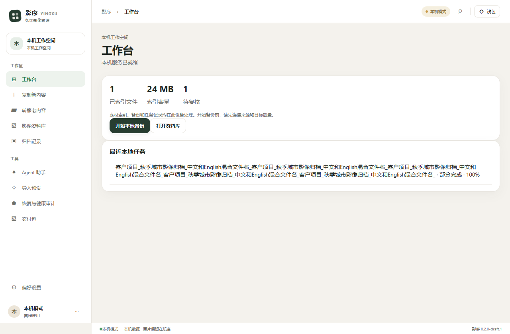
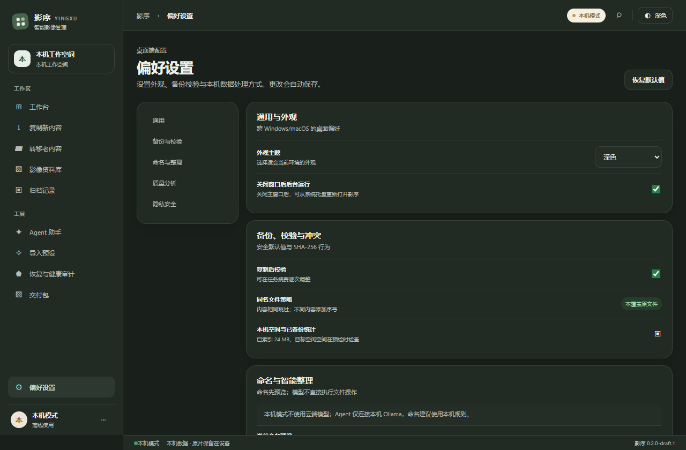
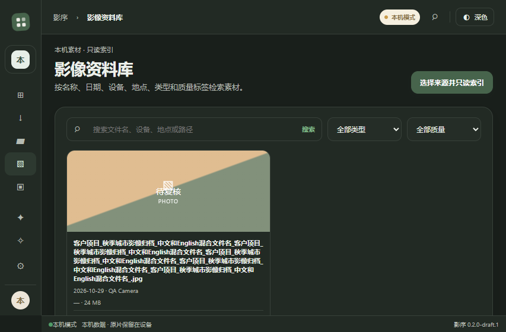

# Windows 桌面审核与整改（2026-10-29）

本轮以 `other-windows-qa` 为交付分支，先合并 `main` 的当前桌面实现（基线 `0a4c3ff`），保留旧 Windows 测试快照与双方历史，再进行本轮整改。版本号仍为 `0.2.0-draft.1`，本记录不代表已经完成商店发布。

## 面向客户的界面整改

- 原生欢迎页直接提供“开始使用”，进入无需账号的本机模式；不展示尚未可用的扫码、验证码和注册入口。浏览器预览仍保留明确的演示标记。
- 产品名与窗口标题改为“影序 / 影序 YINGXU”。去掉原生工作区中的草稿、联调、Rust/SQLite、LangGraph/sidecar 等内部实现文案；诊断 JSON 继续只在开发环境显示。
- 隐藏通知占位按钮、未实现的开机启动/自动分析/相似度设置、模拟高级设置保存及本机模式下的云账号入口。保留实际生效的主题、后台运行与复制校验选项。
- 归档记录改名使用应用内表单，替代 WebView 中不可靠的 `window.prompt`；取消不改记录，保存前仍经过原有本机确认。
- 修正真实转移按钮误标“演示”；未选择目标、未确认来源规则或正在处理时不能提交。
- 支持 Windows 中文字体回退、长任务名/文件名/路径换行、短窗口中弹窗与设置页滚动、预设卡片收缩及深色状态颜色。切换页面重置滚动位置；Agent 页面不再受固定高度挤压，输入区不遮挡设置内容。

## Windows 文件与运行组件修复

- 接受规范化的本机 `\\?\D:\...` 路径，继续拒绝 UNC、网络共享、设备命名空间和相对路径；不对只有盘符前缀的中间组件查询文件元数据。
- 扫描逐个检查文件名，不再把 Windows 多级目录的反斜杠分隔符判为非法文件名。
- Windows 文件标识不再混入写入时间与大小；内容变化仍由完整指纹及 SHA-256 校验。修复新增子项误报根目录变化、写入后临时文件无法识别清理的问题。
- 本机 Agent 的 RSA PEM 在 Windows 凭据库按字节存储，避免 UTF-16 密码编码超过系统长度限制，并兼容读取旧格式。
- 后台 Agent、视频抽帧和凭据辅助进程使用 `CREATE_NO_WINDOW`，避免命令行窗口闪出。
- Python 通用依赖锁中 `uvloop` 排除 Windows。打包验证使用有超时的线程读取管道，兼容 Windows；发布工作流补齐 Agent 资源构建、清单校验和启动烟测。
- CI 增加 Windows 文件操作回归和正式 Vue 构建的页面检查，并在本分支推送时运行。

## 验证结果与证据边界

| 验证 | 结果 |
|---|---|
| `pnpm install --frozen-lockfile`、`pnpm build` | 通过 |
| `pnpm verify:desktop` | 80 组通过：10 页面 × 4 窗口尺寸 × 浅/深色；无页面横向溢出、无未处理 JS 异常 |
| UI 行为 | 原生欢迎页无模拟登录、隐藏未实现控件、切页回顶、改名取消/确认、部分完成状态、生产报告隐藏诊断 JSON，均通过 |
| Windows Rust 核心 | 69 项通过：36 单元 + 6 API/交付 + 21 本地文件操作 + 6 媒体测试 |
| Windows 宿主 | 9 项通过，含字节密钥与旧格式解码、真实打包 Agent 状态/关闭；真实 Ollama 模型用例未启用 |
| 其他前端回归 | 备份状态 8、分页 8、本机模式 10、本机 Agent 10、网盘/IPC 11、直接打开边界 4，以及文件操作和新对话回归通过 |
| Agent 打包验证 | Windows x64 资源清单、健康检查、本机模型状态、忽略继承云凭据、正常关闭通过；当前未运行 Ollama，不宣称模型对话已验收 |
| Agent 工具测试 | 16 项中 14 通过；2 项因当前 Windows 无符号链接创建权限跳过；未修改系统权限 |
| 打包资源扫描 | 1840 文件，常见凭据特征扫描无发现；这不构成穷尽式安全审计 |
| 原生 UI | 本机编译的 Tauri/WebView2 窗口成功启动；本机模式、原生目录选择器、D 盘中文路径只读扫描（2 个合成文件）已实测；密钥修复后真实 Agent 启动成功，准确显示“Ollama 未运行” |

界面尺寸为 `1280×840`、`1024×640`、`760×500`、`853×560`。后者用于较窄逻辑视口检查，不等同于已修改并验收系统 150% DPI。UI 自动测试使用注入的合成原生适配器，不冒充真实磁盘/云服务验收；真实文件行为由 Windows Rust 测试覆盖。

原生验收使用独立应用标识与独立 D 盘测试数据库。工具链、样本、日志、构建和截图均在项目的 `work/`、`outputs/` 中保留并忽略提交。本地打包所用运行环境含额外 SSL 策略文件，已原样随本地测试组件补齐，没有改动证书验证；发布 CI 使用官方 Python。

## 页面截图

以下为正式 Vue 构建配合合成数据的自动截图，便于复核布局：

## 上架前仍需完成

本轮未提交商店、创建发行标签或发布 Release。正式上架仍需选定目标商店并完成对应签名/包格式、安装升级卸载验收和商店材料。现有 NSIS 发行工作流保持草稿发布；完整 CI 与商店审核结果应分别记录。云账号、跨设备同步和网盘实际资质/授权未在本轮启用，Ollama 真实模型对话未验收。Windows 文件标识仍沿用项目的创建时间/属性回退方案，并非卷序列号+文件索引方案。
